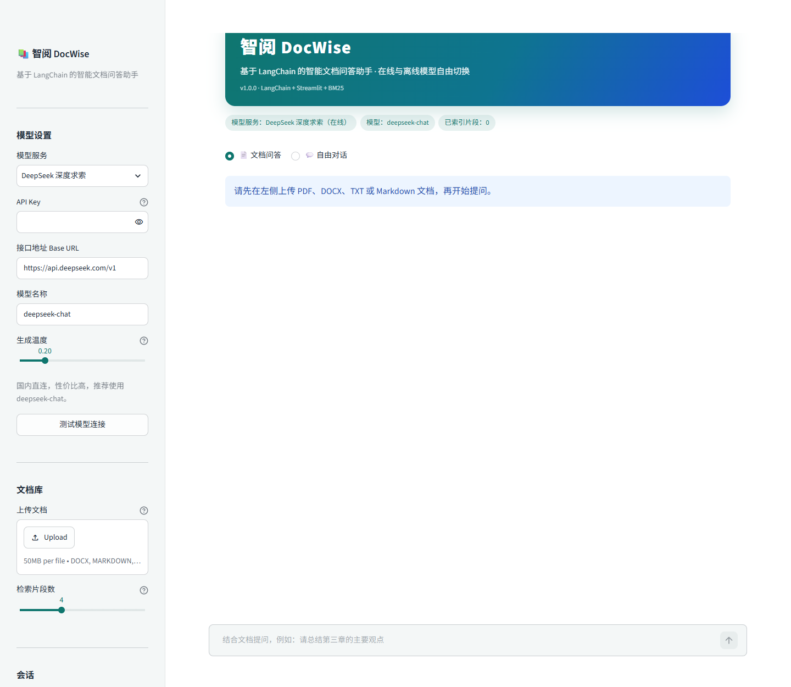
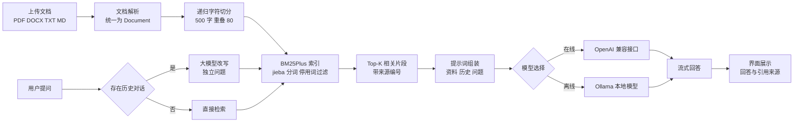

# 智阅 DocWise

> 基于 LangChain 的智能文档问答助手，在线大模型与本地离线模型自由切换。

[](https://www.python.org/)
[](https://python.langchain.com/)
[](https://streamlit.io/)
[](LICENSE)

**开源仓库**：https://github.com/lsqtx/docwise

---

## 一、项目简介

智阅 DocWise 是一款面向学习与办公场景的智能文档问答应用。用户上传 PDF、Word、TXT 或 Markdown 文档后，可以直接用自然语言提问，系统会先从文档中检索相关片段，再交给大模型生成带来源标注的回答。

项目以 LangChain 为核心编排框架，同时支持两类模型：

- 在线大模型：DeepSeek、通义千问、智谱 GLM、月之暗面 Kimi 以及任意 OpenAI 兼容接口。
- 离线大模型：通过 Ollama 在本机运行 qwen2.5 等开源模型，断网也能使用。

检索层采用 BM25 与 jieba 中文分词，不依赖向量模型和外部向量数据库，安装后即可使用，适合课程演示与个人知识库场景。

## 界面预览



## 二、功能特性

| 功能 | 说明 |
| --- | --- |
| 多格式文档解析 | 支持 PDF、DOCX、TXT、Markdown，可一次上传多个文件 |
| 智能文档问答 | 基于检索增强生成，只依据文档内容回答，降低模型幻觉 |
| 来源可追溯 | 回答中的 [片段 1] 等编号对应左侧可展开的原文片段 |
| 多轮对话 | 保留上下文，追问时自动把问题改写成独立问题再检索 |
| 在线与离线模型 | 侧边栏一键切换服务商，兼容 OpenAI 协议与 Ollama |
| 流式输出 | 回答逐字显示，长答案无需等待 |
| 中文友好检索 | BM25 结合 jieba 搜索模式分词，无需下载向量模型 |
| 对话导出 | 一键把当前对话导出为 Markdown 文件 |
| 连接自检 | 内置模型连接测试，配置错误时给出明确提示 |

## 三、技术栈

| 层次 | 技术 | 作用 |
| --- | --- | --- |
| 应用框架 | Streamlit | 构建交互界面与流式聊天体验 |
| 编排框架 | LangChain 0.3 | 文档处理、检索链、提示词与模型调用 |
| 在线模型 | langchain-openai | 调用 DeepSeek 等 OpenAI 兼容服务 |
| 离线模型 | langchain-ollama | 调用本机 Ollama 服务 |
| 检索 | rank-bm25 + jieba | 中文关键词检索与分词 |
| 文档解析 | pypdf + python-docx | 提取 PDF 与 Word 文本 |
| 配置管理 | python-dotenv | 从 .env 读取密钥 |

## 四、系统架构



一次问答的完整流程：

1. 文档上传后按扩展名解析，统一转换为 LangChain 的 Document 对象，并保留文件名与页码。
2. 使用递归字符切分器按中文标点切分，默认每段 500 字、重叠 80 字。
3. 用 jieba 搜索模式分词并过滤虚词，构建 BM25Plus 倒排索引。
4. 用户提问时，如果存在历史对话，先让大模型把追问改写成独立问题。
5. 检索 Top-K 相关片段，按编号与来源拼接成上下文。
6. 提示词要求模型只依据资料回答并标注片段编号。
7. 回答以流式方式输出，界面同步展示引用来源。

## 五、目录结构

```text
docwise/
├── app.py                  # Streamlit 界面入口
├── docwise/
│   ├── __init__.py
│   ├── config.py           # 应用信息与模型服务预设
│   ├── llm.py              # 在线与离线模型工厂
│   ├── loaders.py          # PDF DOCX TXT MD 解析
│   └── rag.py              # 切分 检索 改写 流式回答
├── tests/
│   └── test_rag.py         # 不依赖真实模型的单元测试
├── examples/
│   └── LangChain与检索增强生成.md   # 可直接上传体验的示例文档
├── docs/
│   └── screenshot.png      # 界面预览图
├── .streamlit/
│   └── config.toml         # 主题与上传大小配置
├── .env.example            # 密钥配置模板
├── requirements.txt
├── LICENSE
└── README.md
```

## 六、快速开始

### 1. 克隆仓库

```bash
git clone https://github.com/lsqtx/docwise.git
cd docwise
```

### 2. 创建虚拟环境

Windows PowerShell：

```powershell
python -m venv .venv
.venv\Scripts\Activate.ps1
```

macOS 与 Linux：

```bash
python3 -m venv .venv
source .venv/bin/activate
```

### 3. 安装依赖

```bash
pip install -r requirements.txt
```

### 4. 配置模型

复制配置模板：

```powershell
Copy-Item .env.example .env
```

然后在 .env 中填写实际使用的密钥。只需要填写一个服务即可。

#### 方式一：在线大模型

| 服务 | Base URL | 默认模型 | 密钥变量 | 申请地址 |
| --- | --- | --- | --- | --- |
| DeepSeek | https://api.deepseek.com/v1 | deepseek-chat | DEEPSEEK_API_KEY | https://platform.deepseek.com |
| 阿里云百炼 | https://dashscope.aliyuncs.com/compatible-mode/v1 | qwen-plus | DASHSCOPE_API_KEY | https://bailian.console.aliyun.com |
| 智谱 GLM | https://open.bigmodel.cn/api/paas/v4 | glm-4-flash | ZHIPUAI_API_KEY | https://open.bigmodel.cn |
| 月之暗面 Kimi | https://api.moonshot.cn/v1 | moonshot-v1-8k | MOONSHOT_API_KEY | https://platform.moonshot.cn |

如果使用其他兼容 OpenAI 协议的服务，在界面中选择「OpenAI 兼容自定义」，再填写接口地址与模型名称即可。

#### 方式二：离线大模型 Ollama

1. 从 https://ollama.com 下载并安装 Ollama。
2. 拉取一个中文能力较好的开源模型：

```bash
ollama pull qwen2.5:7b
```

3. 确认服务已启动，默认地址为 http://localhost:11434。
4. 在应用侧边栏选择「Ollama 本地模型」，模型名称填写 qwen2.5:7b。

离线模式下文档解析、检索与生成全部在本机完成，不需要联网，也不需要 API Key。

### 5. 启动应用

```bash
streamlit run app.py
```

浏览器会自动打开 http://localhost:8501。如果端口被占用，可以指定其他端口：

```bash
streamlit run app.py --server.port 8502
```

## 七、使用说明

1. 在左侧选择模型服务，填写 API Key，点击「测试模型连接」确认配置正确。
2. 上传一个或多个文档，等待界面提示索引完成。第一次体验可以直接使用 examples 目录中的示例文档。
3. 在「文档问答」模式中输入问题，例如：这份文档的核心结论是什么。
4. 展开回答下方的「查看引用来源」，核对模型依据的原文片段。
5. 继续追问时，系统会结合上文理解指代关系。
6. 切换到「自由对话」模式，可以不依赖文档直接与模型聊天。
7. 点击「导出对话」保存 Markdown 记录，点击「清空对话」开始新的会话。

## 八、核心实现

### 1. 模型工厂

`docwise/llm.py` 用同一个入口创建在线与离线模型。在线模型统一使用 ChatOpenAI 并指定 base_url，因此接入新服务只需要增加一条预设；离线模型使用 ChatOllama，两者对上层暴露相同的调用方式。

```python
def create_llm(provider, model="", api_key="", base_url="", temperature=0.2):
    preset = PROVIDERS[provider]
    if preset["kind"] == "offline":
        return ChatOllama(model=model, base_url=base_url, temperature=temperature)
    return ChatOpenAI(
        model=model,
        api_key=api_key,
        base_url=base_url,
        temperature=temperature,
        timeout=60,
    )
```

### 2. 中文检索

向量检索通常需要下载 embedding 模型，在离线环境和课程演示中不够轻量。本项目改用 BM25，并用 jieba 的搜索模式做中文分词，兼顾词语与长词拆分。

小语料场景下，BM25Okapi 的逆文档频率可能出现负数，导致公共词压过关键词。项目直接注入 BM25Plus 评分器，并过滤「什么」「可以」「有」等高频虚词，使排序更稳定。

```python
def build_retriever(chunks, k=4):
    vectorizer = BM25Plus([tokenize(chunk.page_content) for chunk in chunks])
    return BM25Retriever(
        vectorizer=vectorizer,
        docs=chunks,
        k=k,
        preprocess_func=tokenize,
    )
```

### 3. 历史感知检索

用户追问「它支持离线吗」时，单独检索这句话效果很差。项目借助 LangChain 的 create_history_aware_retriever，在有历史对话时先改写问题，再执行检索。

```python
chain = create_history_aware_retriever(llm, retriever, CONDENSE_PROMPT)
documents = chain.invoke({"input": question, "chat_history": history})
```

没有历史对话时直接检索，避免一次多余的模型调用。

### 4. 溯源提示词与流式输出

提示词要求模型只使用资料内容，并用 [片段 1] 的形式标注依据。检索片段在拼接时带上编号与来源，界面则把同一批片段放进可展开的来源面板。

```python
chain = QA_PROMPT | llm | StrOutputParser()
for token in chain.stream({"context": context, "chat_history": history, "input": question}):
    yield token
```

### 5. 会话状态管理

Streamlit 每次交互都会重新执行脚本。项目使用 st.session_state 保存文档片段、检索器缓存、两套对话记录与模型配置，并用文件签名判断是否需要重新建立索引，避免重复解析。

## 九、测试

项目内置不依赖真实大模型的单元测试，使用 FakeListChatModel 验证完整调用链：

```bash
python -m unittest discover -s tests -v
```

覆盖内容：

- TXT 的 UTF-8 与 GBK 解码、Markdown 与 DOCX 解析。
- 长文档切分、空文档过滤与元数据保留。
- BM25 中文检索相关性、上下文格式化。
- 历史问题改写后的检索。
- 流式回答链路。

## 十、常见问题

**Q1：提示缺少 API Key 怎么办。**

在 .env 中填写对应服务的密钥，或直接在侧边栏输入。密钥只保存在当前会话，不会写入代码仓库。

**Q2：Ollama 连接失败怎么办。**

先确认 Ollama 已安装并运行，执行 ollama list 能看到模型；再检查侧边栏地址是否为 http://localhost:11434，模型名称是否与列表一致。

**Q3：上传 PDF 后没有解析出内容。**

扫描版 PDF 是图片，无法直接提取文字。可以先用 OCR 工具转换，或改用 DOCX、TXT 文档。

**Q4：回答与文档无关。**

可以尝试降低生成温度、增加检索片段数，或把问题写得更具体。如果文档本身缺少相关信息，模型会明确说明。

**Q5：为什么不用向量数据库。**

本项目的目标是轻量、可离线、零额外模型下载。BM25 对中文关键词问答已经足够稳定，后续可以平滑替换为 FAISS 或 Chroma。

## 十一、后续可扩展方向

- 增加 FAISS 向量检索，与 BM25 组成混合检索。
- 支持扫描件 OCR 与表格结构化解析。
- 增加多文档对比阅读与自动摘要。
- 提供 Dockerfile 与一键部署脚本。
- 增加回答质量评测集，对比不同模型效果。

## 十二、开源协议

本项目采用 MIT License，详见 [LICENSE](LICENSE)。

## 十三、作者

李诗琪 · 软件2405班 · 学号 20245994

如果这个项目对你有帮助，欢迎点亮 Star。
